

  
    
    
    
    
    
  

  
<strong>CEFR COLOR PATH</strong>

  

    
    
    
    
    
    
    
  

  
<strong>FOUR-SKILL COLOR KEY</strong>

  

    
    
    
    
  

  
  
<em>[Fig 01] Plaza de España, Seville — Architectural Symmetry & Structure</em>

> [!IMPORTANT]
> **MISSION:** Build Spanish from absolute beginner (**A0**) to independent, fluent, nuanced command (**C1–C2**).
>
> **CORE RULE:** Duolingo is your **daily practice engine**, not your entire language-learning system. Combine it with listening, speaking, reading, writing, grammar, and real-world feedback.

---

## [00] THE COMPLETE ROADMAP
    

```mermaid
flowchart LR
    A0["<b>A0 // ZERO</b><br/>Start<br/>0%"] --> A1["<b>A1 // SURVIVAL</b><br/>0–2 Months<br/>15%"]
    A1 --> A2["<b>A2 // FOUNDATION</b><br/>2–4 Months<br/>30%"]
    A2 --> B1["<b>B1 // INDEPENDENT</b><br/>4–8 Months<br/>50%"]
    B1 --> B2["<b>B2 // CONFIDENT</b><br/>8–14 Months<br/>70%"]
    B2 --> C1["<b>C1 // ADVANCED</b><br/>14–24 Months<br/>85%"]
    C1 --> C2["<b>C2 // MASTERFUL</b><br/>2+ Years<br/>100%"]

    style A0 fill:#E76F51,stroke:#20243A,stroke-width:2px,color:#fff
    style A1 fill:#F78C6B,stroke:#20243A,stroke-width:2px,color:#fff
    style A2 fill:#F4B942,stroke:#20243A,stroke-width:2px,color:#20243A
    style B1 fill:#06A77D,stroke:#20243A,stroke-width:2px,color:#fff
    style B2 fill:#118AB2,stroke:#20243A,stroke-width:2px,color:#fff
    style C1 fill:#4361EE,stroke:#20243A,stroke-width:2px,color:#fff
    style C2 fill:#8338EC,stroke:#20243A,stroke-width:2px,color:#fff
```

### Input vs. Output Scaling Architecture

| Channel | Early Stages (A0–A2) | Intermediate (B1–B2) | Advanced (C1–C2) | Dynamics |
| :--- | :---: | :---: | :---: | :--- |
| **🎧📖 INPUT** *(Listening / Reading)* |  |  |  | **High Early:** Builds mental model & comprehension |
| **🗣️✍️ OUTPUT** *(Speaking / Writing)* |  |  |  | **Scales Up:** Converts passive knowledge into fluency |

*Timeline is approximate. Progress depends on study time, consistency, exposure, and feedback.*

| Stage | Mastery Meter | Can-Do Goal | Main Focus | Exit Checkpoint |
| :---: | :---: | :--- | :--- | :--- |
|  |  | Start from nothing | Sounds, greetings, basic phrases | Read Spanish alphabet and introduce yourself |
|  |  | Handle simple situations | Present tense, core vocabulary, questions | 2–3 minute self-introduction |
|  |  | Talk about routine and past events | Past tenses, descriptions, everyday exchanges | 5-minute familiar-topic conversation |
|  |  | Explain opinions and experiences | Narrative, future, subjunctive basics | 10-minute conversation; graded reader |
|  |  | Discuss complex topics | Nuance, connectors, natural listening | Follow most native content with support |
|  |  | Use Spanish flexibly | Register, idioms, advanced grammar | Present, debate, and write detailed arguments |
|  |  | Near-expert command | Precision, style, cultural nuance | Understand and express subtle meaning across contexts |

---

## [00.5] DAILY SYSTEM (60–90 MINUTES)
    

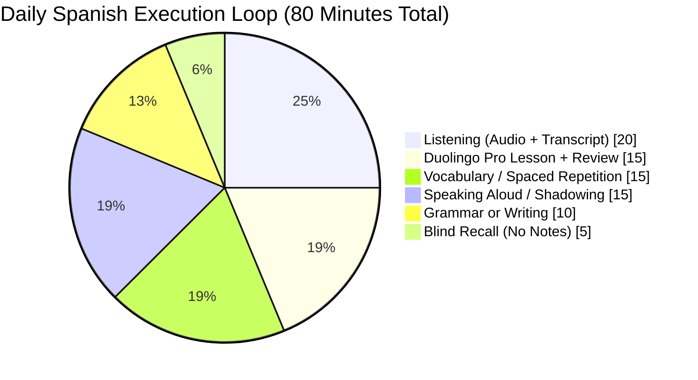

| Time Block | Duration | Core Module | Share |
| :---: | :---: | :--- | :---: |
| `00:00 – 00:15` |  | **Duolingo Pro** lesson + mistake review | `19%` |
| `00:15 – 00:30` |  | **Vocabulary** / spaced repetition (Anki chunks) | `19%` |
| `00:30 – 00:50` |  | **Listening** (comprehensible audio + transcript) | `25%` |
| `00:50 – 01:05` |  | **Speaking aloud** / shadowing native rhythm | `19%` |
| `01:05 – 01:15` |  | **Grammar** pattern drill or short **writing** | `12%` |
| `01:15 – 01:20` |  | **Blind Recall** of yesterday's material without notes | `6%` |

> [!TIP]
> **MINIMUM VIABLE DAY (20 MIN):** On exhausting or high-load days, never hit zero. Execute: **`[10m Duolingo]` + `[5m Listening]` + `[5m Speaking Aloud]`**.

**Weekly Rhythm**
- **Mon–Fri:** Follow the 80-minute daily execution loop.
- **Saturday:** Review weak skills; write a 150–250 word piece (scale to your current CEFR level).
- **Sunday:** Light Spanish media + weekly self-test; plan next week's target.

### Duolingo Pro Workflow

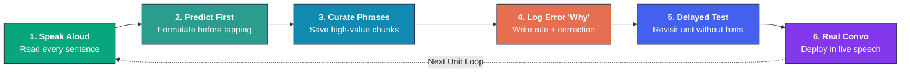

1. Complete the next lesson, but **say every sentence aloud**.
2. Before tapping an answer or word bank, **predict it yourself**.
3. Save **useful** new words/phrases in a personal notebook (avoid collecting every isolated word).
4. Review mistakes: write the corrected sentence and the underlying grammatical reason.
5. Revisit the same unit after a few days and test recall without hints.
6. Use Duolingo's speaking/listening exercises when available; add real conversation elsewhere.

> [!WARNING]
> Do not measure mastery by streak, XP, or unit completion alone. Measure what you can **understand** and **produce from memory**.

---

## [01] PRONUNCIATION & READING (A0 → A1)
    

Spanish spelling is highly phonemic. Master the sound rules first so reading immediately reinforces pronunciation.

| Letter / Pattern | Approximate Sound | Example |
| :--- | :--- | :--- |
| <kbd>a</kbd> <kbd>e</kbd> <kbd>i</kbd> <kbd>o</kbd> <kbd>u</kbd> | *ah, eh, ee, oh, oo* (pure, crisp vowels) | **casa, mesa** |
| <kbd>h</kbd> | always silent | **hola** |
| <kbd>j</kbd> / <kbd>ge</kbd> / <kbd>gi</kbd> | strong breathy "h" (varies by region) | **jamón, gente** |
| <kbd>ñ</kbd> | "ny" as in *canyon* | **niño** |
| <kbd>ll</kbd> / <kbd>y</kbd> | often "y" (regional variation: *sh/zh* in Río de la Plata) | **llave, yo** |
| <kbd>r</kbd> | single alveolar tap between vowels | **pero** |
| <kbd>rr</kbd> / initial <kbd>r</kbd> | rolled / trilled *r* | **perro, rojo** |
| <kbd>c + e/i</kbd> | "th" in Spain; "s" in Latin America | **cinco** |
| <kbd>z</kbd> | "th" in Spain; "s" in Latin America | **zapato** |
| <kbd>qu + e/i</kbd> | "k" sound; *u* is silent | **queso** |
| <kbd>güe</kbd> / <kbd>güi</kbd> | pronounce the *u* ("gweh / gwee") | **pingüino** |

### Spanish Syllabic Stress Engine

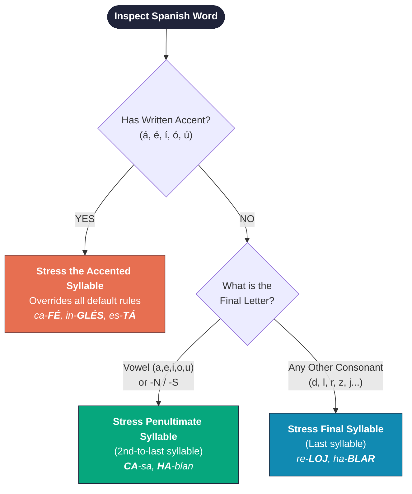

### Accent Marks Change Meaning (Diacritical Tildes)

| With Accent | Meaning | Without Accent | Meaning |
| :---: | :--- | :---: | :--- |
| **sí** | yes | **si** | if |
| **tú** | you *(subject)* | **tu** | your *(possessive)* |
| **él** | he *(pronoun)* | **el** | the *(masculine article)* |
| **más** | more / plus | **mas** | but *(literary)* |
| **¿Qué? / ¡Qué!** | what / how *(question/exclamation)* | **que** | that *(relative conjunction)* |

### First Speaking Drill
Read slowly focusing on pure vowels, then repeat at natural conversational speed:
- `Hola. Me llamo ___.`
- `Soy de India.`
- `Estoy aprendiendo español.`
- `¿Cómo estás? Estoy bien, gracias.`
- `Mucho gusto. ¡Hasta luego!`

---

## [02] A1 FOUNDATIONS
    

### Essential Sentence Architecture

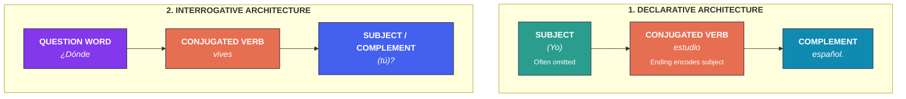

Spanish frequently omits subject pronouns because the verb ending already identifies the speaker:
- **(Yo) hablo español.**
- Include **yo** only for emphasis or contrast: **Yo hablo; él no.**

### Subject Pronouns

| Person | Singular (Spanish → English) | Plural (Spanish → English) |
| :--- | :--- | :--- |
| **1st Person** | **yo** → I | **nosotros / nosotras** → we |
| **2nd Person (Informal)** | **tú** → you *(informal singular)* | **vosotros / vosotras** → you plural *(mainly Spain)* |
| **3rd Person / Formal** | **él / ella / usted** → he / she / you *(formal)* | **ellos / ellas / ustedes** → they / you plural *(LatAm uses **ustedes** for all plural)* |

### Articles & Gender Agreement

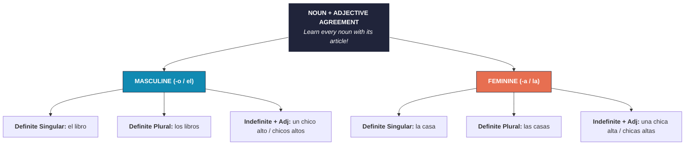

### "To Be" Decision Tree: SER vs. ESTAR vs. HAY

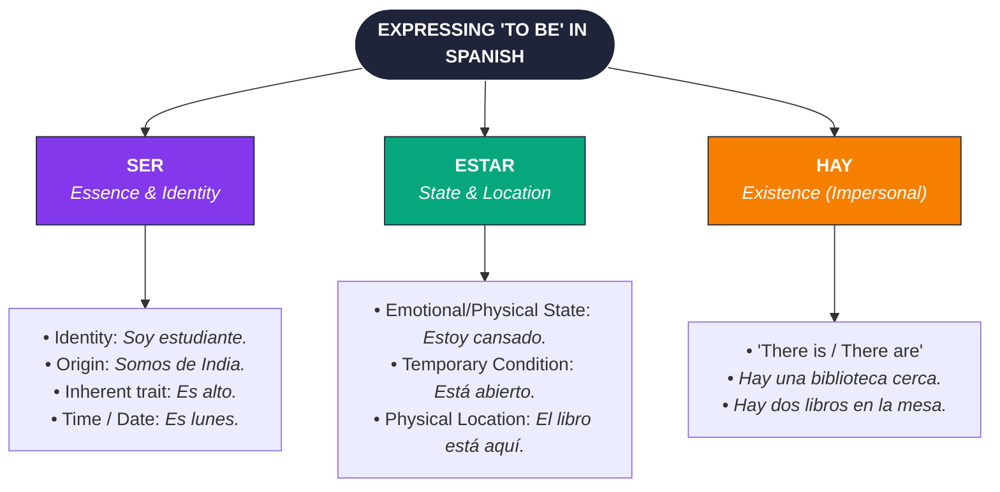

**Starter Contrast (How SER vs. ESTAR Shifts Meaning):**
- **Es aburrido.** = He/it is boring *(defining characteristic)* **vs.** **Está aburrido.** = He is bored *(current state)*.
- **Es listo.** = He is clever/smart **vs.** **Está listo.** = He is ready.

### Present Tense: Regular Verbs

| Pronoun | `-AR`: hablar | `-ER`: comer | `-IR`: vivir |
| :--- | :--- | :--- | :--- |
| **yo** | habl**o** | com**o** | viv**o** |
| **tú** | habl**as** | com**es** | viv**es** |
| **él / ella / usted** | habl**a** | com**e** | viv**e** |
| **nosotros/as** | habl**amos** | com**emos** | viv**imos** |
| **vosotros/as** | habl**áis** | com**éis** | viv**ís** |
| **ellos / ustedes** | habl**an** | com**en** | viv**en** |

### High-Frequency Irregulars — Master Early

| Verb | yo | tú | él/ella/ud. | nosotros/as | ellos/ustedes |
| :--- | :--- | :--- | :--- | :--- | :--- |
| **ser** *(to be)* | soy | eres | es | somos | son |
| **estar** *(to be)* | estoy | estás | está | estamos | están |
| **tener** *(to have)* | tengo | tienes | tiene | tenemos | tienen |
| **ir** *(to go)* | voy | vas | va | vamos | van |
| **hacer** *(to do/make)* | hago | haces | hace | hacemos | hacen |
| **decir** *(to say/tell)* | digo | dices | dice | decimos | dicen |
| **poder** *(can/to be able)* | puedo | puedes | puede | podemos | pueden |
| **querer** *(to want/love)* | quiero | quieres | quiere | queremos | quieren |
| **venir** *(to come)* | vengo | vienes | viene | venimos | vienen |
| **saber** *(to know facts)* | sé | sabes | sabe | sabemos | saben |

### Stem-Changing Verbs (The "Boot Verb" Architecture)

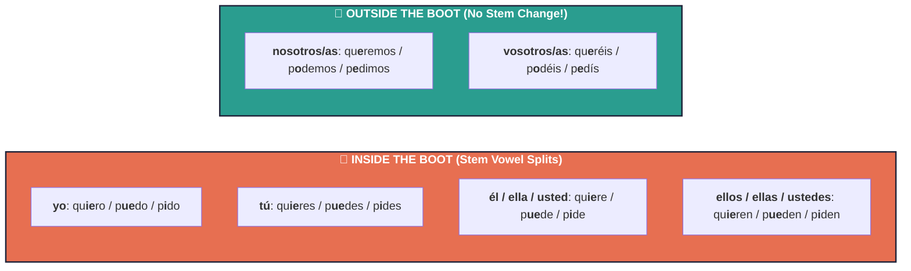

### Negation & Questions
- **No** goes directly before the verb: **No entiendo.**
- Yes/no question (intonation + inverted mark): **¿Hablas español?**
- Core Interrogatives (always carry an accent mark!): **qué** (what), **quién** (who), **cuándo** (when), **dónde** (where), **por qué** (why), **cómo** (how), **cuánto/a/os/as** (how much/many), **cuál/es** (which).
- Contrast: **¿Por qué?** = why **vs.** **porque** = because.

### A1 Survival Vocabulary Buckets

| Category Bucket | High-Frequency Core Items |
| :--- | :--- |
|  | **hola, buenos días, buenas tardes, buenas noches, adiós, hasta mañana** |
|  | **por favor, gracias, de nada, perdón, disculpe** |
|  | **persona, amigo/a, familia, hombre, mujer, niño/a** |
|  | **casa, escuela, tienda, estación, baño, ciudad** |
|  | **agua, pan, arroz, fruta, café, leche, pollo** |
|  | **numbers (1–100), days, months, telling time, colors, directions** |
|  | **ser, estar, tener, hacer, ir, querer, poder, hablar, comer, vivir, necesitar** |

> [!NOTE]
> **A1 OUTPUT MISSION:** Introduce yourself, order food, ask directions, describe family/home, tell time, and handle simple daily transactions.

---

## [03] A2: EVERYDAY LIFE & PAST EVENTS
    

### Past Tense Aspect Map

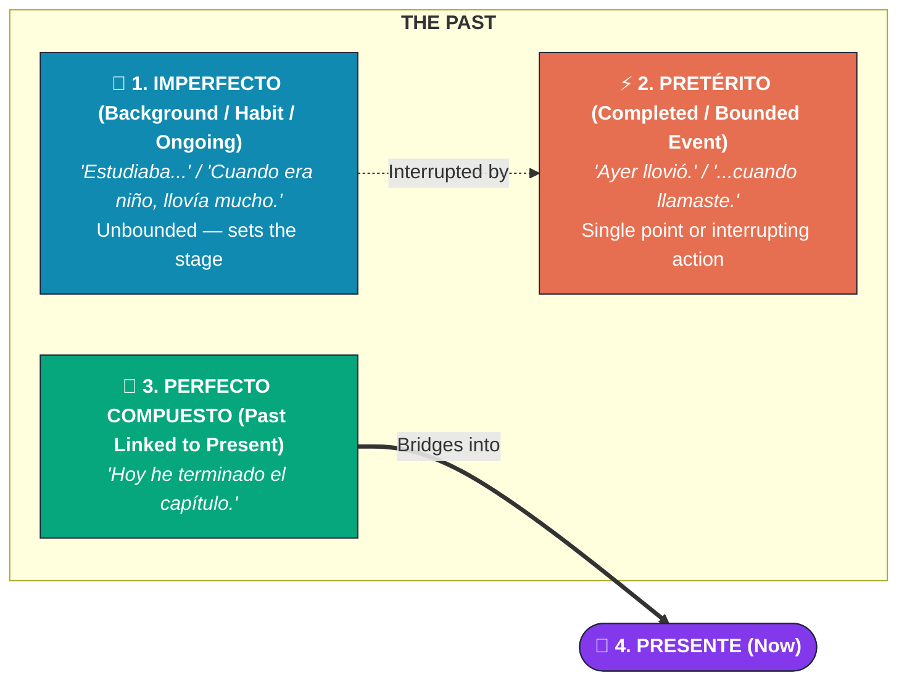

### Pretérito vs. Imperfecto Regular Endings

| Person | Pretérito `-AR` | Pretérito `-ER / -IR` | Imperfecto `-AR` | Imperfecto `-ER / -IR` |
| :--- | :---: | :---: | :---: | :---: |
| **yo** | `-é` | `-í` | `-aba` | `-ía` |
| **tú** | `-aste` | `-iste` | `-abas` | `-ías` |
| **él / ella / usted** | `-ó` | `-ió` | `-aba` | `-ía` |
| **nosotros/as** | `-amos` | `-imos` | `-ábamos` | `-íamos` |
| **vosotros/as** | `-asteis` | `-isteis` | `-abais` | `-íais` |
| **ellos / ustedes** | `-aron` | `-ieron` | `-aban` | `-ían` |

- **Pretérito Irregular Stems:** **tener** → `tuv-`, **estar** → `estuv-`, **hacer** → `hic-` (**hizo**), **ir/ser** → `fui`, **poder** → `pud-`, **poner** → `pus-`, **decir** → `dij-`.
- **Imperfecto Only Has 3 Irregulars:** **ser** → `era`, **ir** → `iba`, **ver** → `veía`.
- **Narrative Combination Example:** **Estudiaba** *(imperfect background)* cuando **llamaste** *(preterite interruption)*.

### Reflexive Verbs, Gustar & The Double-Pronoun Collision Rule

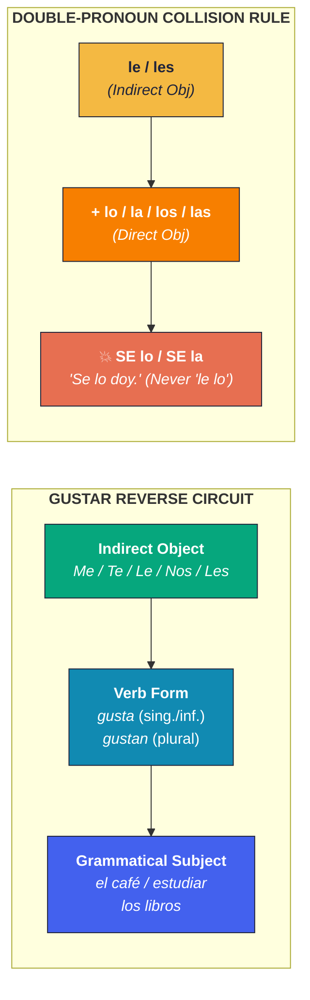

| Pattern | Pronouns | Core Examples |
| :--- | :--- | :--- |
| **1. Reflexive Verbs** *(Subject acts on self)* | `me, te, se, nos, os, se` | **Me levanto** a las siete. *(levantarse, ducharse, vestirse, acostarse)* |
| **2. Gustar-Style Verbs** *(Thing liked = Subject)* | `me, te, le, nos, os, les` | **Me gusta** el café. / **Me gustan** los libros. *(encantar, interesar, importar, faltar)* |
| **3. Direct & Indirect Objects** | DO: `lo, la, los, las` IO: `me, te, le (se), nos, os, les (se)` | *Veo el libro* → **Lo veo.** *Doy el libro a Ana* → *Le + lo doy* → **Se lo doy.** |

### Comparisons
- `más ... que` = more ... than | `menos ... que` = less ... than
- `tan ... como` = as ... as
- `mejor / peor` = better / worse | `mayor / menor` = older / younger

> [!NOTE]
> **A2 OUTPUT MISSION:** Explain your daily routine, describe a past weekend, talk about plans, shop, travel, and narrate a connected story.

---

## [04] B1: INDEPENDENT SPANISH
    

### Future & Conditional Infinitive Engine

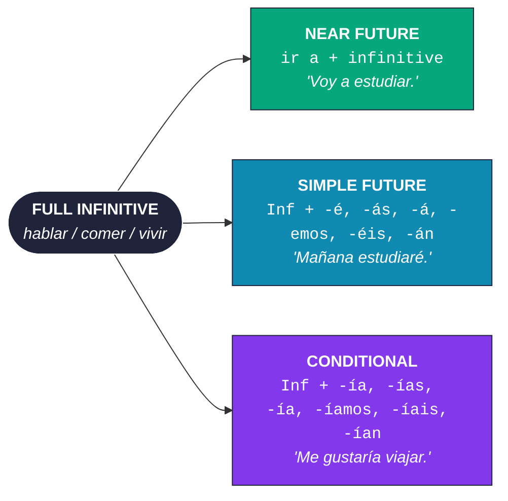

**Shared Irregular Stems (Identical for Both Simple Future & Conditional):**
`decir → dir-` | `hacer → har-` | `tener → tendr-` | `poder → podr-` | `querer → querr-` | `venir → vendr-` | `salir → saldr-`

### Present Perfect & Imperative Commands
- **Present Perfect Formula:** `haber (he, has, ha, hemos, habéis, han)` + `past participle (-ado / -ido)` → **He hablado / hemos comido**.
- **Irregular Participles:** **hecho, dicho, visto, escrito, puesto, vuelto, abierto, muerto**.
- **Affirmative `tú` Commands:** Use 3rd-person present (**habla, come, vive**). Irregular shortcuts: `di, haz, ve, pon, sal, sé, ten, ven`.
- **Negative & Formal Commands:** Switch to the **Present Subjunctive** (**No hables. No comas. Hable, por favor.**).

### The Subjunctive Circuit Architecture

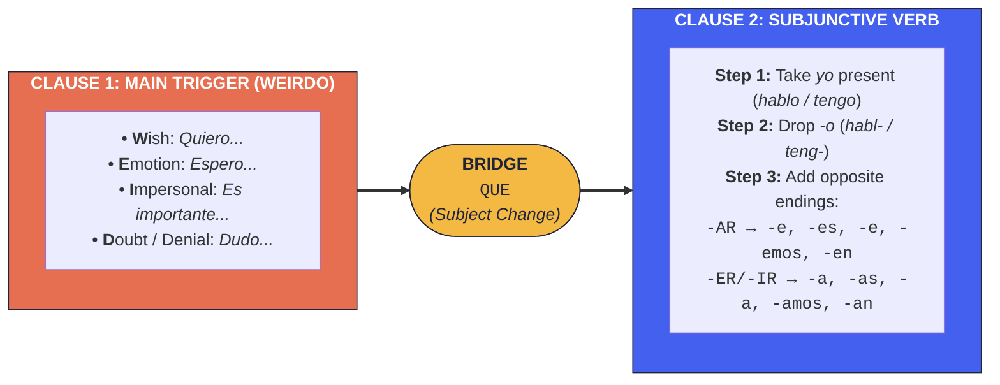

**Indicative vs. Subjunctive Contrast:**
- `Sé que viene.` *(Asserted certainty → **Indicative**)* **vs.** `Espero que venga.` *(Wish/non-guaranteed → **Subjunctive**)*
- `Busco el libro que está aquí.` *(Specific known item → **Indicative**)* **vs.** `Busco un libro que sea fácil.` *(Hypothetical/desired item → **Subjunctive**)*

### Discourse Connectors for Fluent Speech

| Function | Discourse Connectors |
| :--- | :--- |
| **Sequence** | **primero, luego, después, finalmente** |
| **Reason** | **porque, ya que, debido a que, como** |
| **Result** | **por eso, así que, por lo tanto, de modo que** |
| **Contrast** | **pero, aunque, sin embargo, mientras que, en cambio** |
| **Opinion** | **en mi opinión, creo que, desde mi punto de vista, a mi juicio** |
| **Examples** | **por ejemplo, es decir, en otras palabras, o sea** |

> [!NOTE]
> **B1 OUTPUT MISSION:** Tell connected stories, explain opinions, handle unexpected travel problems, discuss work/study, and sustain conversations with follow-up questions.

---

  
  
<em>[Fig 02] Guanajuato, Mexico — Expanding Across Dialects & The Spanish-Speaking World</em>

---

## [05] B2: CONFIDENT & NUANCED COMMUNICATION
    

**Core B2 Grammatical & Stylistic Targets:**
- **Imperfect Subjunctive:** **hablara / hablase**, **comiera / comiese**.
- **Hypothetical `Si` Clauses:** **Si tuviera más tiempo, viajaría por Sudamérica.**
- **Past Perfect (Pluscuamperfecto):** **había + participle** (**Cuando llegué, ya habían salido.**).
- **Passive & Impersonal `se`:** **Se habla español; Se venden apartamentos.**
- **Relative Pronouns:** **que, quien, el cual, la que, cuyo, donde, lo que**.
- **Reported Speech (Estilo Indirecto):** **Me dijo que estaba cansado y que vendría mañana.**
- **Register Control:** Shifting effortlessly between casual (`tú/vos`), neutral, and formal (`usted`) contexts.

### B2 Native Immersion Loop

```mermaid
flowchart LR
    N1["<b>1. Native Content</b><br/>Podcast / Article / Film"] --> N2["<b>2. First Pass</b><br/>Listen/Read for Gist"]
    N2 --> N3["<b>3. Second Pass</b><br/>Analyze Details & Structure"]
    N3 --> N4["<b>4. Extract 3–5 Chunks</b><br/>Idioms & Collocations"]
    N4 --> N5["<b>5. Synthesize</b><br/>Summarize Aloud or in Writing"]
    N5 --> N6["<b>6. Feedback Audit</b><br/>Verify & Correct Errors"]
    N6 --> N7["<b>7. Active Deployment</b><br/>Reuse Chunks Next Week"]
    N7 -.-> N1

    style N1 fill:#118AB2,color:#fff,stroke:#20243A
    style N2 fill:#00B4D8,color:#fff,stroke:#20243A
    style N3 fill:#06A77D,color:#fff,stroke:#20243A
    style N4 fill:#F4B942,color:#20243A,stroke:#20243A
    style N5 fill:#F77F00,color:#fff,stroke:#20243A
    style N6 fill:#E76F51,color:#fff,stroke:#20243A
    style N7 fill:#8338EC,color:#fff,stroke:#20243A
```

> [!NOTE]
> **B2 OUTPUT MISSION:** Debate news, society, technology, culture, and abstract ideas; defend viewpoints with structured evidence and counterarguments.

---

## [06] C1–C2: ADVANCED TO MASTERY
    

|  |  |
| :--- | :--- |
| • Understand long lectures, films, rapid podcasts, and implied meaning without strain. | • Achieve **precision and stylistic control** — not merely "more vocabulary." |
| • Speak spontaneously at length with clear rhetorical structure. | • Decode ambiguity, double entendres, wordplay, subtext, and rhetorical intent. |
| • Write cohesive essays, technical reports, critiques, and executive communications. | • Adapt register seamlessly across academic, literary, professional, and street settings. |
| • Master natural transitions, subtle tone shifts, idioms, and regional variation. | • Produce publication-grade arguments and nuanced creative/persuasive writing. |
| • Recognize irony, understatement, cultural humor, and historical references. | • Comprehend diverse regional accents and overlapping fast speech effortlessly. |

### Advanced Grammar Mastery Checklist
- [ ] All indicative tenses and aspectual distinctions
- [ ] Present, imperfect, present perfect, and pluperfect subjunctive
- [ ] Sequence of tenses (*concordancia temporal*) across complex clauses
- [ ] All three conditional clause types (real, hypothetical present, counterfactual past: *Si hubiera sabido, habría ido*)
- [ ] Advanced relative pronouns (*el cual, quienquiera, cuyo*) and clitic pronoun placement
- [ ] Passive voice (`ser + participle`) vs. `estar + participle` vs. impersonal/passive `se`
- [ ] Advanced **ser/estar** adjective shifts and **por/para** idiomatic extensions
- [ ] Régimen preposicional (`verb + required preposition`: *soñar con, insistir en, tardar en, depender de*)
- [ ] Nuanced reported speech and formal register shifts
- [ ] Regional *voseo* / *ustedeo* / *leísmo* awareness and idiomatic discourse markers

---

## [07] THE "NEVER CONFUSE THESE" DESK
  

### POR vs. PARA Vector Compass

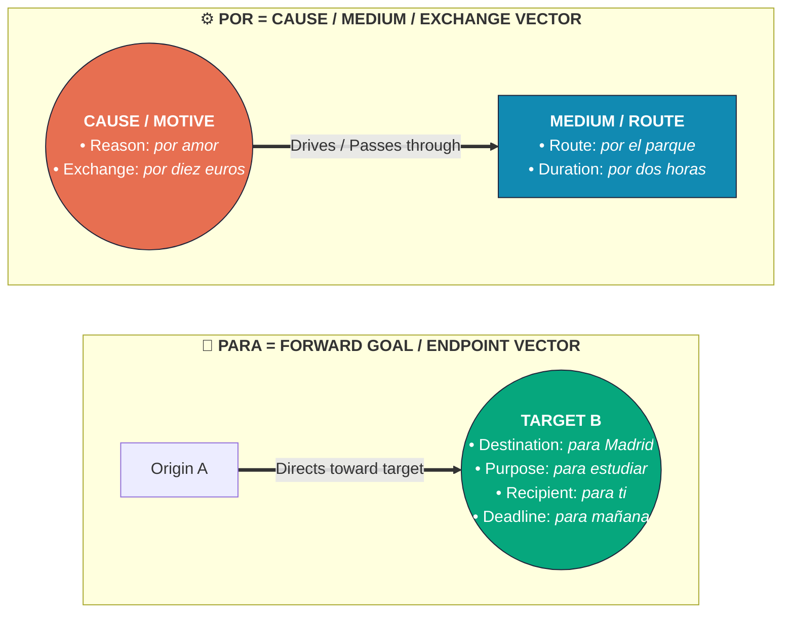

### High-Frequency Contrast Pairs

| Contrast Pair | Rule & Mental Model | Authentic Examples |
| :--- | :--- | :--- |
| **Saber vs. Conocer** | **saber** = facts, information, skills (*saber + inf.*) **conocer** = familiarity with people, places, or fields | **Sé** la respuesta; **sé** nadar. **Conozco a** María; **conozco** Madrid. |
| **Muy vs. Mucho** | **muy** = modifies adjectives & adverbs *(invariable)* **mucho/a/os/as** = modifies nouns *(agrees)* or verbs | Es **muy** bueno; habla **muy** rápido. Tengo **mucha** agua, **muchos** libros; estudio **mucho**. |
| **Hay vs. Está(n)** | **hay** = existence of non-specific item(s) **está / están** = location of specific, named item(s) | **Hay** una farmacia en esta calle. **La** farmacia **está** cerca; **las** llaves **están** aquí. |

### Temporal Expressions: Desde vs. Desde Hace vs. Hace

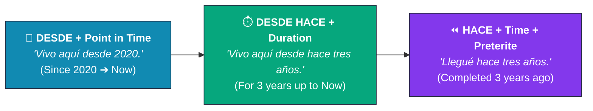

---

## [08] VOCABULARY MASTERY SYSTEM
    

Never memorize isolated dictionary words. Acquire vocabulary through **contextual chunks**:

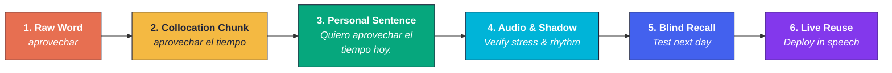

### Vocabulary Themes by Stage
- **A1:** identity, family, numbers, time, food, home, school, survival verbs.
- **A2:** daily routine, health, shopping, travel, weather, hobbies, past experiences.
- **B1:** work, academics, relationships, plans, emotions, news, expressing opinions.
- **B2:** society, environment, technology, economics, culture, abstract concepts.
- **C1–C2:** specialized domain terminology, idioms, proverbs, literary register, subtle synonyms.

### Spaced Repetition Interval Schedule

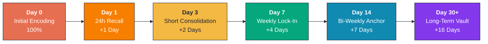

---

## [09] THE 4-SKILL ESCALATION MATRIX
      

| Level | 🎧 Listening Escalation | 🗣️ Speaking Escalation | 📖 Reading Escalation | ✍️ Writing Escalation |
| :---: | :--- | :--- | :--- | :--- |
|  | Fast multi-accent native media & slang | Spontaneous nuance, irony & rhetoric | Satire, classic literature & specialized texts | Polished register tailored to any audience |
|  | Unassisted films, lectures & debates | Structured debate & formal presentations | Editorials, academic papers & long-form journalism | Cohesive formal essays & analytical reports |
|  | Native podcasts with episode notes | 15–20m fluid conversation + follow-ups | Contemporary novels, essays & Spanish news | 300–500 word structured argument |
|  | Familiar-topic videos with ES subtitles | 3–5 minute recorded monologue | Short stories, learner news & articles | 150–250 word narrative or opinion piece |
|  | Slow conversational dialogues | 1-minute daily Q&A responses | Graded readers (A2) & personal messages | 80–120 word routine or past-weekend entry |
|  | Slow beginner audio + full transcript | Read sentences aloud & shadow phrases | Short dialogues, menus & signs | 5–8 simple sentences about yourself |

### Skill Execution Protocols
- **🎧 Listening Method:** `Listen for gist` → `Identify key chunks` → `Replay with transcript` → `Shadow 20–60 seconds` → `Summarize aloud`.
- **🗣️ Shadowing Protocol:** Listen to a short native phrase, pause, imitate exact rhythm/melody/stress, record yourself, and compare. Prioritize **intelligibility and prosody** over erasing your accent.
- **✍️ 5-Pass Writing Revision:** `1. Meaning` → `2. Verb/Gender Grammar` → `3. Vocabulary Precision` → `4. Natural Connectors` → `5. Accents & Punctuation`.

---

## [10] WEEKLY TOPIC ROTATION
  

| Day | Primary Focus | Daily High-Impact Deliverable |
| :--- | :---: | :--- |
| **Monday** |  | Master one structural pattern; write **10 original sentences** using it. |
| **Tuesday** |  | Complete **15–30 min** comprehensible audio + record a spoken summary. |
| **Wednesday** |  | Record a **2–5 minute unscripted monologue**; audit hesitations. |
| **Thursday** |  | Read one short article/chapter; extract **5 reusable phrase chunks**. |
| **Friday** |  | Write a journal entry or essay; run the 5-pass revision + log corrections. |
| **Saturday** |  | Live session with a tutor/partner or simulated role-play dialogue. |
| **Sunday** |  | Blind recall quiz, Error Log audit, update dashboard, set next week's target. |

---

## [11] MILESTONE TESTS (PROVE YOUR PROGRESS)
  

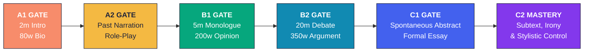

| Level Gate | Verification Checklist (Pass All 4 Before Advancing) |
| :---: | :--- |
|  | - [ ] Introduce yourself aloud for 2 minutes without notes - [ ] Ask and answer 20 basic personal/daily questions - [ ] Understand a slow 1-minute beginner dialogue - [ ] Write 80 words about yourself from memory |
|  | - [ ] Describe your daily schedule and family in detail - [ ] Narrate yesterday's events combining preterite and imperfect - [ ] Complete a restaurant, shopping, and directions role-play - [ ] Understand the main points of a short learner podcast |
|  | - [ ] Speak continuously for 5 minutes on a familiar topic - [ ] Explain a real-world problem and propose a solution - [ ] Write a connected 200-word opinion piece - [ ] Follow the gist of a normal-speed podcast on a familiar subject |
|  | - [ ] Hold a 15–20 minute natural conversation with a native speaker - [ ] Present a claim backed by reasons and address a counterargument - [ ] Watch a native news segment and summarize its key points - [ ] Write a structured 350-word argumentative essay |
|  | - [ ] Understand a long native lecture or film with minimal support - [ ] Discuss abstract, technical, or cultural topics spontaneously - [ ] Write a coherent, well-structured formal essay or report - [ ] Shift tone intentionally between formal and informal audiences |
|  | - [ ] Interpret subtext, irony, regional idioms, and rhetorical choices - [ ] Understand diverse native speakers across dialects and genres - [ ] Express subtle shades of meaning with effortless precision - [ ] Produce stylistically controlled speech and writing |

---

  
  
<em>[Fig 03] The Alhambra, Granada — Mastery Through Precision, Nuance & Craft</em>

---

## [12] CURATED RESOURCE STACK
  

| Tool / Resource | Category | Role in Your System |
| :--- | :---: | :--- |
| **Duolingo Pro** |  | Structured daily lessons, repetition, and baseline habit-building. |
| **SpanishDict** |  | Fast dictionary, full conjugation tables, and clear grammar breakdowns. |
| **Language Transfer** |  | First-principles audio course for building mental sentence architecture. |
| **Dreaming Spanish** |  | Graded comprehensible-input listening videos sorted from Superbeginner to Advanced. |
| **Anki** |  | Automated spaced-repetition flashcards for high-value phrase chunks & error fixes. |
| **Graded Readers** |  | Level-calibrated narratives to build reading speed without dictionary fatigue. |
| **iTalki / Conversation Partner** |  | Real-time conversation practice, pressure-testing, and live error correction. |
| **Native Podcasts, News & Books** |  | Authentic cultural and linguistic immersion from B1 through C2. |

> [!TIP]
> **ANTI-BLOAT RULE:** Pick **one primary resource per skill**. Resource-hopping creates the illusion of progress while resetting your momentum.

---

## [13] PROGRESS & ERROR DIAGNOSTIC DASHBOARD
    

Update every Sunday during your weekly review block:

| Week | Duolingo Units | 🎧 Listening (mins) | 🗣️ Speaking (mins) | 📖 Reading (pages) | ✍️ Writing (words) | Weakest Skill | Next Week's Target |
| :---: | :---: | :---: | :---: | :---: | :---: | :---: | :--- |
| **1** | `___` | `___` | `___` | `___` | `___` | `___________` | `___________` |
| **2** | `___` | `___` | `___` | `___` | `___` | `___________` | `___________` |
| **3** | `___` | `___` | `___` | `___` | `___` | `___________` | `___________` |
| **4** | `___` | `___` | `___` | `___` | `___` | `___________` | `___________` |

### Error Diagnostic Log Template
Every recurring mistake is a high-yield upgrade opportunity. Log errors using this structured table:

| Diagnostic Field | Entry Example | Blank Template |
| :--- | :--- | :--- |
| **📅 Date** | `2026-11-04` | `YYYY-MM-DD` |
| **❌ My Sentence** | *Yo gusto el café.* | `[Write original error]` |
| **✅ Corrected Sentence** | **Me gusta el café.** | `[Write corrected Spanish]` |
| **🔍 Root Cause (Why)** | *Gustar* means "to be pleasing to"; *el café* is the subject and requires the indirect object pronoun **me**. | `[Grammar / Gender / Tense / Preposition rule]` |
| **🧪 Fresh Verification Sentence** | **Me gustan mucho los libros de historia.** | `[Create 1 brand-new sentence using the rule]` |
| **🔁 Scheduled Review** | `2026-11-07 (+3d)` / `2026-11-11 (+7d)` | `YYYY-MM-DD (+3d / +7d)` |

### Monthly Reflection Audit
1. What can I now produce automatically **without translating in my head**?
2. Which specific grammar point or tense still causes hesitation?
3. Which regional accents or media speeds can I now follow comfortably?
4. Can I speak continuously for longer than I could 30 days ago?
5. What is my **single measurable bottleneck target** for next month?

---

## [14] FIRST 30 DAYS — BOOTCAMP SPRINT
    

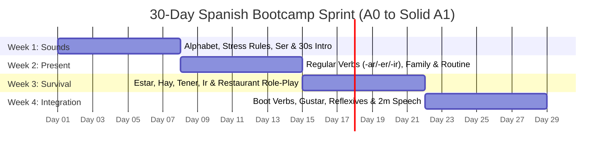

| Sprint Week | Progress | Core Curriculum | Friday/Sunday Output Deliverable |
| :---: | :---: | :--- | :--- |
| **Week 1** *Sounds & Intro* |  | Alphabet, pure vowels, syllabic stress, greetings, subject pronouns, **ser**, noun gender/articles. | Record a **30-second self-introduction** aloud. |
| **Week 2** *Present Basics* |  | Regular `-ar` / `-er` / `-ir` present verbs, negation, question words, numbers, days, time, family. | Describe your **family and daily routine** in 8–10 sentences. |
| **Week 3** *Everyday Survival* |  | **estar**, **hay**, adjective agreement, **tener**, **ir**, food, home, city places, directions. | Complete an unscripted **restaurant & directions role-play**. |
| **Week 4** *Build & Audit* |  | Boot stem-changers (`e→ie`, `o→ue`, `e→i`), **gustar**, reflexive routine verbs, full Week 1–3 error audit. | Speak for **2 minutes**, write **100 words**, pass A1 listening check. |

> [!IMPORTANT]
> **DAY 30 GATE CHECK:** Can you introduce yourself, ask simple questions, describe your routine, understand slow basic speech, and write a 100-word paragraph? If any piece feels shaky, consolidate before rushing into A2 past tenses.

---

## [15] 10 LAWS FOR LONG-TERM MASTERY
  

| # | Core Principle | Execution Rule |
| :---: | :--- | :--- |
| `01` | **Consistency Beats Intensity** | A non-negotiable 60-minute daily loop crushes sporadic 5-hour weekend binges. |
| `02` | **Understand Before Memorizing** | Always ask *what job* a grammar structure performs before drilling endings. |
| `03` | **Active Recall Beats Rereading** | Close the notes and force your brain to retrieve and produce Spanish from scratch. |
| `04` | **Collect Phrases, Not Isolated Words** | Words live in collocations (*tomar una decisión*, *darse cuenta de*). |
| `05` | **Speak From Day One** | Vocalize every sentence aloud from Lesson 1, even when studying solo. |
| `06` | **Prioritize Comprehensible Input** | Choose audio and texts where you understand ~80–90% so context teaches the rest. |
| `07` | **Fix High-Frequency Errors First** | Target the 20% of mistakes that appear in 80% of your sentences. |
| `08` | **Anchor One Dialect, Respect All** | Choose Spain or Latin America for your own output, but train your ear on both. |
| `09` | **Build Direct Mental Associations** | Link Spanish words directly to images, feelings, and scenarios—not English translations. |
| `10` | **CEFR Levels Are Real-World Abilities** | App trophies don't equal fluency; milestone speaking and listening tests prove mastery. |

---

## [16] FINAL SYSTEM ARCHITECTURE
  

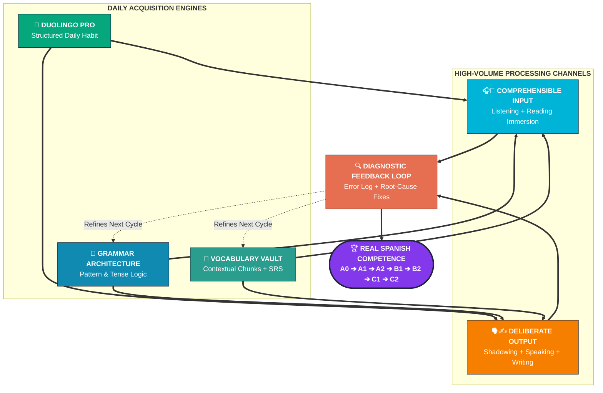

> [!IMPORTANT]
> **YOUR IMMEDIATE NEXT ACTION:** Start with **Section [01] Pronunciation** + **Week 1 of the Bootcamp**. Today, complete one Duolingo Pro session reading every sentence aloud, and write **five original Spanish sentences** from memory.

  

